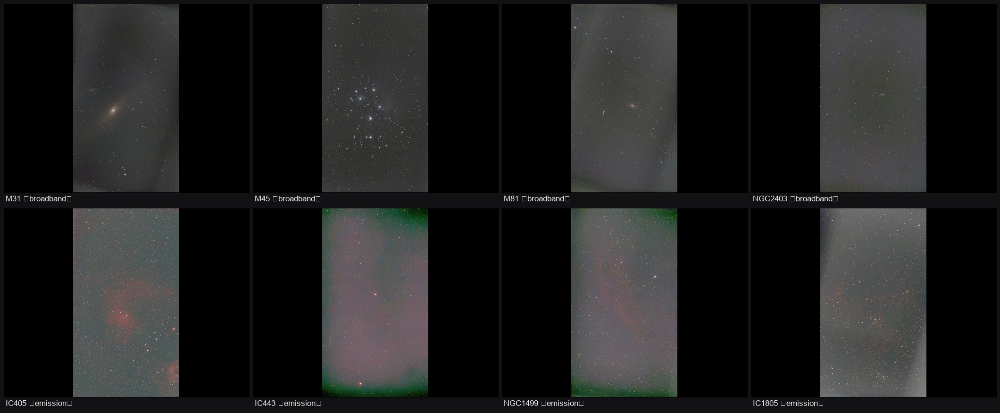

# Seestar Night Agent

让 AI Agent 全权托管一台 **ZWO Seestar S30 Pro**，在市区窗台上完成整夜无人值守的深空拍摄，并把成品图自动拉回本地做后期处理。

2026-10-19 的一夜实拍结果：**8 个深空目标、391 分钟有效曝光、零人工干预**。



---

## 这套方案解决什么问题

Seestar 自带的 App 需要人守着：换目标要手动点、天气变差不会自己收工、拍完还得一张张导出来。

本项目把整个流程串成一条**与 AI 会话解耦**的进程链：

```
svchost
  └─ powershell night_watchdog.ps1      ← 进程守护，崩了自动拉起
       └─ python night_runner.py         ← 真正的调度器
            └─ seestar-mcp → Alpaca 127.0.0.1:5555 → seestar_alp → 设备
```

关键点是**关掉 AI 客户端不影响拍摄**。三个守护进程挂在 Windows 计划任务下，AI 只是"监工"，不是"命脉"。

### 能力

- **自动换目标**：按时间表 goto → 对焦 → 开拍 → 监控 → 收尾，全程无人值守
- **自动判断天气**：接 open-meteo 逐小时预报，低云遮挡就停拍折叠，转晴再续
- **保护设备**：电量 < 20%、机身 > 80°C、断连 > 10 分钟、方位角超限，任一触发即停拍收臂
- **崩溃自愈**：`STOPPED` 标记区分「正常收尾」与「真崩溃」，只对后者重启
- **成品回传**：自动从设备 HTTP 拉成品 JPG，并单独下载 16-bit FITS 做后期

---

## 实拍成果

| 目标 | 类型 | 帧数 | 单帧 | 累积 | 滤镜 | 评价 |
|---|---|---|---|---|---|---|
| M31 仙女座大星系 | 星系 | 367 | 10s | 61 min | IRCUT | 最优 |
| IC1805 心脏星云 | 发射星云 | 281 | 10s | 47 min | IRCUT | 滤镜错，需重拍 |
| NGC1499 加州星云 | 发射星云 | 145 | 20s | 48 min | IRCUT | 滤镜错，需重拍 |
| M45 昴星团 | 反射星云 | 285 | 10s | 48 min | IRCUT | 良好 |
| IC405 火焰星云 | 发射星云 | 196 | 20s | 65 min | LP | 正确 |
| IC443 水母星云 | 超新星遗迹 | 178 | 20s | 59 min | LP | 正确 |
| M81 波德星系 | 星系 | 305 | 10s | 51 min | IRCUT | 良好 |
| NGC2403 | 星系 | 74 | 10s | 12 min | IRCUT | 时间不足 |

后期成品在 [`results/processed/`](results/processed/)，机内原图对比在 [`results/processed/compare/`](results/processed/compare/)。

### 后期处理为什么必要

设备机内 JPG 只用了约 **13–31/255** 的动态范围，而设备上同时存着 16-bit 的 `.fit` 文件（65536 级）。同一份数据，后期前后差别是数量级的：

| 目标 | 机内 JPG 动态范围 | 后期动态范围 | 提升 |
|---|---|---|---|
| IC1805 | 17 | 42 | +147% |
| NGC1499 | 13 | 28 | +115% |
| M31 | 19 | 29 | +53% |
| M45 | 24 | 35 | +46% |
| IC405 | 31 | 44 | +42% |
| M81 | 16 | 21 | +31% |
| NGC2403 | 14 | 18 | +29% |
| IC443 | 16 | 20 | +25% |

---

## 快速开始

### 前置要求

- Windows 10/11（守护进程依赖计划任务与 PowerShell）
- Python 3.11 或 3.12
- 一台 Seestar（本项目在 S30 Pro / 固件 9.75 上验证；S50 理论上兼容）
- 望远镜与电脑在同一局域网

### 1. 安装依赖

```bat
python scripts\install.py
```

这会在 `vendor\` 下为两个上游项目分别创建虚拟环境。**必须是两套环境**，因为 `seestar_alp` 与 `seestar-mcp` 的 numpy 版本要求互相冲突。

### 2. 配置

编辑 `config\config.toml`，把 `ip_address` 改成你的望远镜地址：

```toml
[seestar_initialization]
ip_address = "192.168.x.x"
interop_pem = "seestar_client_key.pem"
```

### 3. 启动后端

```bat
1-启动Seestar后端.bat
```

看到 `Startup Complete` 即就绪。Web 界面在 <http://localhost:5432/>，Alpaca 在 `127.0.0.1:5555`。

### 4. 体检

```bat
0-部署体检.bat
```

逐项检查：后端端口、设备连接、RSA 认证、指向精度、天气源、计划任务。全部通过再进下一步。

### 5. 排计划

编辑 `scripts\night_plan.json`。用 `replan_gap.py` 可以先扫出你的窗口里能拍到什么：

```bat
python scripts\replan_gap.py
```

它会输出每个候选目标在你的方位角/高度窗口内的连续可拍区间。

### 6. 开始无人值守

```bat
3-开始无人值守.bat
```

之后可以关掉窗口去睡觉。想随时看状态就运行：

```bat
python scripts\quick_status.py
```

---

## 目录结构

```
seestar-agent/
├── scripts/                 核心脚本（16 个）
│   ├── night_runner.py      调度器：goto/对焦/曝光/滤镜/天气/硬停
│   ├── night_watchdog.ps1   进程守护，崩溃重启 + 收尾强制 park
│   ├── night_monitor.py     每分钟独立巡检，独立于 runner
│   ├── night_plan.json      观测计划
│   ├── quick_status.py      一键状态快照
│   ├── install.py           依赖安装
│   ├── process_fits.py      FITS 后期处理流水线
│   ├── process_all.py       批量后期
│   ├── download_night.py    从设备下载成品 FITS
│   ├── fetch_results.py     拉取成品 JPG
│   ├── replan_gap.py        按窗口扫可拍目标
│   ├── az_path_new.py       方位角/电缆行程校验
│   ├── make_compare.py      机内 vs 后期对比图
│   ├── contact_sheet.py     全景九宫格
│   ├── morning_report.py    晨间总结
│   └── check.ps1            部署体检
├── vendor/                  上游项目快照（含本地修复）
│   ├── seestar_alp/         Alpaca 后端
│   └── seestar-mcp/         MCP 服务端
├── config/                  设备连接配置
├── docs/                    详细文档
├── dev/                     一次性调试脚本（保留备查，非运行必需）
├── results/                 实拍成果
└── data/                    运行时数据（不入库）
```

---

## 三个值得记录的坑

这一夜最大的收获不是照片，而是踩出来的三个 bug。它们的共同特征是：**设备返回"成功"，但实际没生效**。

### 1. 天气停止导致机械臂反复起落

天气转差 → 运行器停拍折叠并正常退出 → 监工看到"心跳中断"就重启 → 重新 goto → 天气仍差 → 又停。

一小时里机械臂展开折叠了三次，每次转 120°。修法是三层：`STOPPED` 标记让监工区分正常收尾与崩溃；天气不佳改为"折叠等待"而非终止整晚；goto 之前先做天气预检，避免白转一趟。

### 2. 曝光设置在叠加中被静默拒绝

想从 20s 改成 10s，调用 `set_setting` 返回 `result: 0`、`ErrorNumber: 0`，看起来成功。实际错误藏在 `Value.error` 里：

```
"error": "stack is already running", "code": 259
```

正确顺序是：**停叠加 → 设置 → 读回校验 → 重启叠加**。

### 3. 滤镜被 `iscope_start_stack` 重置

这个查了最久。设好 LP 滤镜，一开拍就变回 IRCUT，日志还写着"滤镜 -> 2 (LP)"。

三轮实验后确认：`iscope_start_stack` 无论 `restart` 真假都会把轮位重置为 1。**唯一有效的顺序是开拍之后、`state == working` 时再设一次**。

验证方法不要看日志，要看设备上的文件名：

```
Light_IC405_20.0s_IRCUT_...   ← 错
Light_IC405_20.0s_LP_...      ← 对
```

这一条让前四个目标（IC1805 / NGC1499 / NGC1499 / M45）全部用了错误的滤镜。

---

## 已知限制

- **无制冷传感器**：CCD 温度 38–41°C，热噪声是主要噪声源。单帧 10s 在夏季偏短。
- **市区光害**：目视极限约 3.5–4 等。
- **场旋**：地平式支架，目标接近天顶时场旋明显。计划里把高度上限压在 75°。
- **窗口极窄**：az 330°→110°（跨正北），很多目标拍不到。
- **IC1805 与 NGC1499 需重拍**：这两个发射星云在滤镜修复前拍摄，Hα 信号缺失，后期救不回。

---

## 文档

| 文档 | 内容 |
|---|---|
| [部署与使用](docs/部署与使用.md) | 完整安装、网络配置、34 个 MCP 工具、故障排查 |
| [今晚操作卡](docs/今晚操作卡.md) | 现场速查、天气判据、收工流程、关键指标 |
| [观测计划](docs/观测计划-东北窗.md) | 窗口分析、可见目标、方位角排序 |
| [技术复盘](docs/社群分享帖.md) | 全过程记录与经验总结 |

---

## 致谢

- [seestar_alp](https://github.com/smart-underworld/seestar_alp) — Alpaca 后端与设备协议实现
- [seestar-mcp](https://github.com/joshuagillmore/seestar-mcp) — MCP 服务端
- [open-meteo](https://open-meteo.com/) — 免费逐小时天气预报
- [astropy](https://www.astropy.org/) — 坐标与可见性计算

两个上游项目以快照形式放在 `vendor/` 下。`seestar-mcp` 含一处本地修复（`alpaca_client.py` 的 `trust_env=False`，防止 Windows 系统代理拦截发往 localhost 的 Alpaca 请求）。

---

## 许可

本项目自有代码以 MIT 许可发布。`vendor/` 下的两个项目各自遵循其原始许可。
